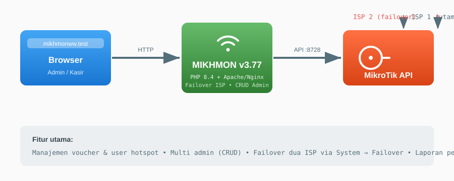
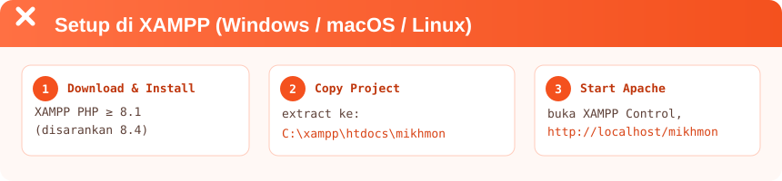
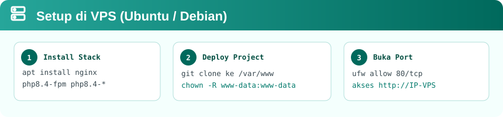
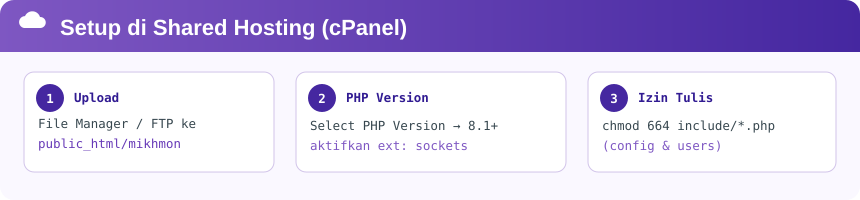

<p align="center">
  
</p>

# mikhmon-v3.77

Mikhmon dari Laksamadi Guko ([laksa19.github.io](https://laksa19.github.io)), saya hanya bantu update:

| Fitur | Keterangan |
|---|---|
| :zap: **PHP 8.4** | Upgrade support PHP 8.1 s/d 8.4 |
| :busts_in_silhouette: **Add User di Admin** | CRUD user admin (multi user login) — menu *Users* |
| :arrows_counterclockwise: **Failover ISP** | Dua sumber ISP dengan failover otomatis — menu *System → Failover* |

---

## Arsitektur Singkat

<p align="center">
  
</p>

Mikhmon berjalan sebagai aplikasi web PHP yang berkomunikasi dengan router MikroTik melalui **API port 8728**. Browser admin/kasir mengakses Mikhmon via HTTP, dan Mikhmon yang mengelola hotspot user, voucher, laporan penjualan, hingga failover dua ISP.

---

## Persyaratan

- **PHP ≥ 8.1** (disarankan 8.4) dengan ekstensi `sockets`
- Web server: **Apache** (XAMPP) atau **Nginx + PHP-FPM**
- Router MikroTik dengan **API service aktif** (IP → Service → api, port 8728)
- Akses tulis ke folder aplikasi (untuk menyimpan config & user)

> [!IMPORTANT]
> Pastikan **API service** di MikroTik sudah enable. Tanpa itu Mikhmon tidak bisa terhubung.
> Cek di Winbox: **IP → Services**, pastikan `api` berstatus *running* pada port 8728.

---

## 1. Setup di XAMPP (Windows / macOS / Linux)

<p align="center">
  
</p>

### Langkah detail

1. **Download & install XAMPP** versi PHP ≥ 8.1 dari [apachefriends.org](https://www.apachefriends.org).
2. **Download / clone project ini**, lalu extract ke folder web root:
   - Windows: `C:\xampp\htdocs\mikhmon`
   - macOS / Linux: `/Applications/XAMPP/htdocs/mikhmon` atau `/opt/lampp/htdocs/mikhmon`
3. **Jalankan Apache** dari XAMPP Control Panel.
4. Buka browser ke:
   ```
   http://localhost/mikhmon/admin.php?id=login
   ```
5. Login default:
   ```
   Username : mikhmon
   Password : 1234
   ```
6. Tambahkan router pertama Anda lewat menu **Add Router**:
   - Isi IP MikroTik (mis. `192.168.88.1`), user, password MikroTik, dan nama session.
   - Klik **Save**, lalu klik session tersebut untuk connect.

<details>
<summary><b>:wrench: Jika gagal koneksi di XAMPP</b></summary>

- Pastikan PC/server Mikhmon dan MikroTik saling terjangkau (`ping 192.168.88.1`).
- Aktifkan ekstensi sockets: buka `php.ini`, hilangkan `;` pada baris `extension=sockets`, restart Apache.
- Port API tidak boleh diblokir firewall.
</details>

---

## 2. Setup di VPS (Ubuntu / Debian)

<p align="center">
  
</p>

### Langkah detail

1. **Install Nginx + PHP 8.4 FPM:**
   ```bash
   sudo apt update
   sudo apt install -y nginx php8.4-fpm php8.4-cli php8.4-mbstring
   ```
2. **Deploy project:**
   ```bash
   cd /var/www
   sudo git clone https://github.com/wiratmoko1708/mikhmon-v3.77.git mikhmon
   sudo chown -R www-data:www-data /var/www/mikhmon
   ```
3. **Konfigurasi Nginx** — buat `/etc/nginx/sites-available/mikhmon`:
   ```nginx
   server {
       listen 80;
       server_name _;
       root /var/www/mikhmon;
       index index.php;

       location ~ \.php$ {
           try_files $uri =404;
           fastcgi_pass unix:/run/php/php8.4-fpm.sock;
           fastcgi_index index.php;
           include fastcgi_params;
           fastcgi_param SCRIPT_FILENAME $document_root$fastcgi_script_name;
       }
       location / {
           try_files $uri $uri/ /index.php?$query_string;
       }
   }
   ```
   Aktifkan site dan reload:
   ```bash
   sudo ln -s /etc/nginx/sites-available/mikhmon /etc/nginx/sites-enabled/
   sudo nginx -t && sudo systemctl reload nginx
   ```
4. **Buka firewall:**
   ```bash
   sudo ufw allow 'Nginx Full'
   ```
5. Buka `http://IP-VPS/admin.php?id=login` dan login dengan `mikhmon` / `1234`.

> [!TIP]
> Untuk HTTPS gratis gunakan Let's Encrypt: `sudo apt install certbot python3-certbot-nginx && sudo certbot --nginx`

### Alternatif: Docker

Project ini sudah disertakan `docker-compose.yml` (termasuk RouterOS untuk test-lab):

```bash
docker-compose up -d
```

Akses Mikhmon di `http://localhost:8080`, dan Winbox test-lab di `http://localhost:8081`.
Detail skenario testing ada di bagian bawah file `docker-compose.yml` pada repo asli.

---

## 3. Setup di Shared Hosting (cPanel)

<p align="center">
  
</p>

### Langkah detail

1. **Upload semua file** project ke folder `public_html/mikhmon` melalui File Manager cPanel atau FTP (FileZilla). Atau lebih cepat, upload zip lalu klik **Extract**.
2. **Set versi PHP** minimal 8.1:
   - Masuk cPanel → **Select PHP Version** (atau *MultiPHP Manager*).
   - Pilih PHP **8.1 / 8.2 / 8.4**, pastikan ekstensi **sockets** dicentang.
3. **Izin file** yang perlu ditulis oleh aplikasi:
   ```bash
   chmod 664 include/config.php
   chmod 664 include/users.php
   chmod 664 include/lang.php
   ```
   Di File Manager: klik kanan file → **Change Permissions**.
4. Akses `http://domain-anda.com/mikhmon/admin.php?id=login`.

> [!WARNING]
> Shared hosting umumnya memblokir koneksi keluar port 8728. Jika Mikhmon "Not Connected", hubungi provider hosting dan minta akses outbound TCP **8728** ke IP MikroTik Anda, atau gunakan VPS.

---

## Setelah Install

| Menu | Fungsi |
|---|---|
| **Admin Settings** | Kelola daftar router/session MikroTik |
| **Users** | CRUD user admin yang boleh login ke Mikhmon |
| **System → Failover** | Konfigurasi failover dua ISP |
| **Hotspot** | User list, voucher, profile, active, hosts, binding |
| **Report** | Laporan penjualan & user log |

### Menambah user admin baru
Masuk ke menu **Users** (di Admin Settings) → isi Username, Password, konfirmasi password → klik **Tambah**. User baru langsung bisa dipakai login.

---

## Keamanan

- Segera ganti password default `mikhmon/1234` setelah install (menu **Users** → edit).
- Gunakan HTTPS di VPS/hosting publik.
- Batasi akses ke halaman admin hanya dari IP tepercaya bila memungkinkan.

## Lisensi

GPLv2 — lihat [LICENSE](LICENSE).

## Kredit

- Original author: [Laksamadi Guko](https://laksa19.github.io) (MIKHMON V3)
- API Class: [routeros-api](https://github.com/BenMenking/routeros-api)